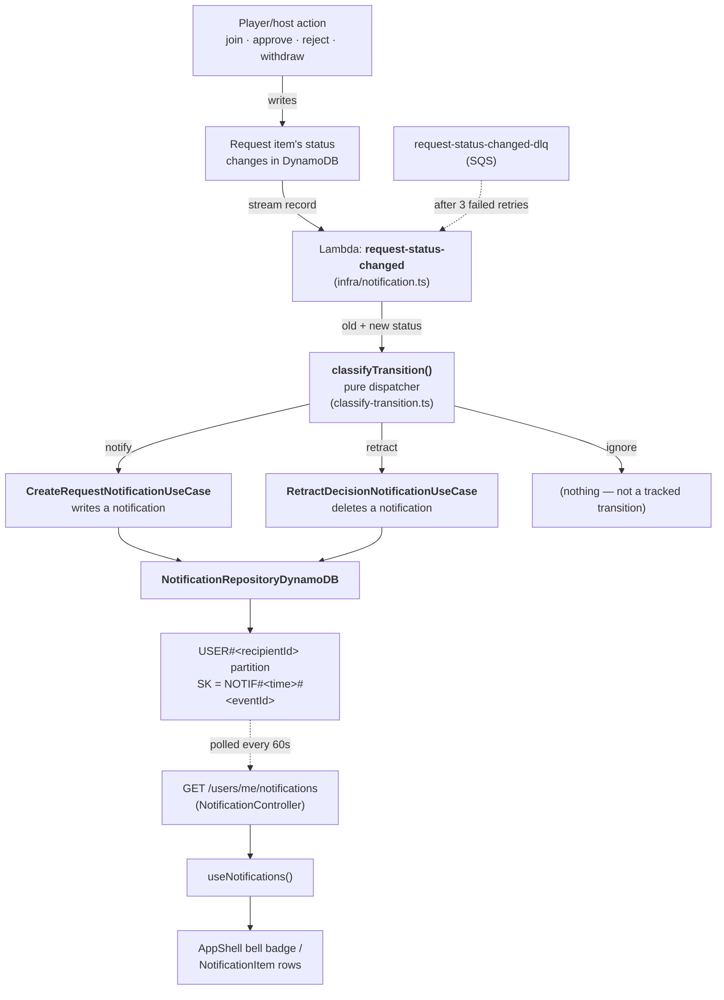

# Request-Lifecycle Notifications — Architecture

One sentence to hold onto: **a request's status changes in DynamoDB → the table's stream
notices → one Lambda classifies what happened → it writes (or deletes) a row in the right
person's notification list → the frontend polls for it and shows a bell badge.**

Everything below is that sentence, zoomed in. See `DATABASE_DESIGN.md` §5 for the data model
these names write to, and `please-check-the-newly-velvet-waffle.md` /
`drifting-doodling-rocket.md` for the plans that introduced this in two passes (withdrawal-only,
then generalized to every status transition).

## The flow

The Lambda's event source mapping filters to `SK` beginning with `REQUEST#` and `eventName` in
`INSERT`/`MODIFY` — cheap at the AWS level, before any code runs — and `classifyTransition`
does the precise old-status/new-status dispatch in code, since the six transitions it
distinguishes would exceed an event source mapping's 5-filter limit. If a batch fails all 3
retries, it lands in the dead-letter queue instead of being silently dropped.

## Every name, pinned to its job

**Stream side (triggered by a DynamoDB change, never by a person asking):**

| Name | What it actually is | Where it lives |
|---|---|---|
| `request-status-changed` | The **Lambda's name** — what you'd look up in the AWS console or `.sst/log/lambda/` under `sst dev`. Named after the *trigger*, not the output — "notification Lambda" is the intuitive name, but not the real one. | `infra/notification.ts` declares it; its code is `request-status-changed.handler.ts` |
| `classifyTransition` | The **pure function** that looks at "status before" + "status after" and decides what to do. Zero AWS/Nest imports on purpose, so it's unit-testable with no mocking. | `classify-transition.ts` |
| `CreateRequestNotificationUseCase` | Writes a new notification — covers `REQUEST_CREATED`, `REQUEST_APPROVED`, `REQUEST_REJECTED`, `REQUEST_WITHDRAWN` | `application/notification/create-request-notification.use-case.ts` |
| `RetractDecisionNotificationUseCase` | Deletes an existing notification — only ever fires on a host's undo | `application/notification/retract-decision-notification.use-case.ts` |
| `NotificationStreamModule` | DI wiring for the Lambda specifically. Deliberately **not** the same module the HTTP routes use — it skips Cognito/auth entirely, since nothing is "asking" here | `infrastructure/ioc/notification-stream.module.ts` |
| `NotificationRepositoryDynamoDB` | The only thing that talks to DynamoDB for notifications: `create`, `deleteDecisionNotifications`, `listForUser`, `getReadAt`, `markAllRead` | `infrastructure/dynamodb/repository/notification.repository.ts` |
| `Notification` | The domain entity — a typed bag of fields (`recipientId`, `type`, `actorName`, ...) before it becomes a DynamoDB item | `domain/notification/notification.entity.ts` |
| `request-status-changed-dlq` | The dead-letter queue — where a batch goes after 3 failed retries, instead of vanishing silently | `infra/notification.ts` |

**HTTP side (triggered by a person asking, never by the stream):**

| Name | What it actually is |
|---|---|
| `NotificationModule` | The *other* DI wiring — this one does need auth, since a real person is asking "show me *my* notifications" |
| `NotificationController` | `GET /users/me/notifications` (list) and `PATCH /users/me/notifications/read` (mark all read) |
| `ListNotificationsUseCase` / `MarkNotificationsReadUseCase` | What the controller actually calls |

**Frontend (what you see):**

| Name | What it actually is |
|---|---|
| `useNotifications` | Polls `GET /users/me/notifications` every 60s |
| `NotificationItem` | One row's UI — text, link target, urgency tint, "Approved" badge |
| `unreadCount` | Pure function comparing each notification's timestamp against the read watermark |
| `useMarkNotificationsRead` | Fires `PATCH .../read` automatically once the page loads with anything unread |
| `AppShell`'s bell badge | `unreadCount`, capped at "9+" |

## The one structural fact that ties it together

There are two separate entry points into this same system, and that split is *why* there are
two DI modules:

- **The stream side** only ever *writes or deletes* rows — it's reacting to a database change,
  so it never needs to prove who's asking.
- **The HTTP side** only ever *reads or marks-read* — a real person is asking, so it needs auth.

Confusing the two (as happened once — see the module-split bug in the session history) means
the stream Lambda ends up pulling in auth machinery it has no `link` to, and crashes on every
cold start before processing a single record.
